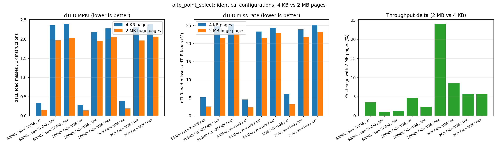
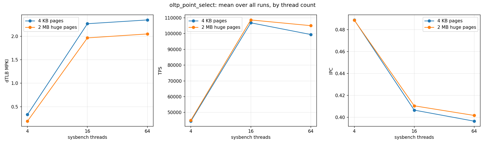
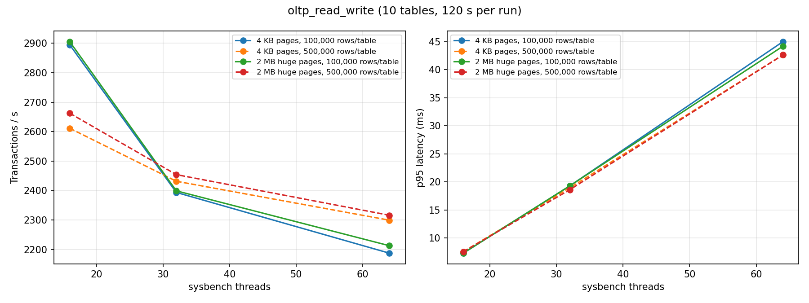

# Huge Pages vs 4 KB Pages for PostgreSQL: a TLB-Level Performance Study

How much does backing a database's shared memory with **2 MB huge pages** instead of the default
**4 KB pages** really help? This project measures it on Linux using PostgreSQL, `sysbench` and hardware
performance counters (`perf stat`). It ties the change in **dTLB misses** to the change in throughput,
IPC and tail latency.

**Takeaways**

- For an in-memory, CPU-bound OLTP workload (`oltp_point_select`), 2 MB pages cut **dTLB load misses per
  1k instructions by 10–53 % (median −15 %)** and raised **throughput by a median +4.8 %** across 9
  matched configurations.
- The gain is largest at low concurrency. At 4 threads dTLB MPKI is halved.
- For a write-heavy workload (`oltp_read_write`), the gain shrinks to **+0.2 % to +2 %**. That workload is
  bound by WAL, locking and I/O, not address translation, so fewer TLB misses barely matter. Huge pages are
  not a universal win, and counters show why.

## Why it matters

Each TLB miss triggers a page-table walk (up to 4 dependent memory accesses on x86-64). PostgreSQL's
`shared_buffers` is one large shared mapping, and every backend process touches it at random. With 4 KB
pages, a 4 GB buffer pool needs about 1 M PTEs, far beyond what the TLB can cover. With 2 MB pages it needs
about 2 K entries. In theory this reduces dTLB misses and page-walk cycles. The study checks how much of
that reaches end-to-end throughput.

## Repository layout

```
scripts/
  tlb_perf_sweep.sh     oltp_point_select sweep + perf stat on all postgres PIDs (dataset × shared_buffers × threads)
  oltp_rw_sweep.sh      oltp_read_write throughput / latency sweep (table size × threads)
  hugepages_advisor.sh  computes vm.nr_hugepages for the running server
  hugepages_status.sh   verifies shared memory is really backed by 2 MB pages (/proc/meminfo, smaps)
analysis/
  analyze.py            parses raw logs -> tidy CSVs, paired 4k-vs-2mb deltas, plots
data/                   raw sysbench + perf logs (source of truth)
  point_select_perf/{4k,2mb}/r_<dataset>_<threads>t_<shared_buffers>.txt
  oltp_read_write/{4k,2mb}/run_ts<rows>_th<threads>.log
results/                generated CSVs and figures
docs/setup.md           environment setup (PostgreSQL, huge page pool, THP, perf)
```

## Methodology

| | Experiment 1: TLB counters | Experiment 2: mixed OLTP |
|---|---|---|
| Workload | `sysbench oltp_point_select` (read-only, primary-key lookups) | `sysbench oltp_read_write` |
| Datasets | 4 tables × {650 K, 2.6 M, 5.2 M} rows (~500 MB / 2 GB / 4 GB) | 10 tables × {100 K, 500 K} rows |
| `shared_buffers` | one value below and one above the dataset size | fixed (same for both page modes) |
| Threads | 4, 16, 64 | 16, 32, 64 |
| Duration | 30 s warm-up + 60 s measured; `perf stat` samples a 50 s steady-state window | 120 s |
| Metrics | TPS, avg/p95 latency, dTLB/iTLB loads & misses, cycles, instructions, cache misses | TPS, QPS, avg/p95 latency |

Page size is the only variable. THP is disabled (`transparent_hugepage=never`), and the 2 MB runs use
`huge_pages = on` with a pre-reserved pool (see [docs/setup.md](docs/setup.md)). `perf stat` attaches to
**every** postgres process: the postmaster, background workers and the backends serving sysbench.

Derived metrics: **dTLB MPKI** = dTLB-load-misses / instructions × 1000. MPKI is the main metric because,
unlike the miss *ratio*, it does not depend on how a given CPU defines the `dTLB-loads` event. Also
computed: IPC = instructions / cycles.

## Results

### Experiment 1: `oltp_point_select`, matched configurations



| dataset | shared_buffers | threads | dTLB MPKI 4 KB | dTLB MPKI 2 MB | Δ MPKI | TPS 4 KB | TPS 2 MB | Δ TPS |
|---|---|--:|--:|--:|--:|--:|--:|--:|
| 500MB | 256MB | 4 | 0.33 | 0.16 | −52.6 % | 43 873 | 45 440 | +3.6 % |
| 500MB | 256MB | 16 | 2.36 | 1.97 | −16.5 % | 104 788 | 105 940 | +1.1 % |
| 500MB | 256MB | 64 | 2.39 | 2.03 | −15.1 % | 100 710 | 101 992 | +1.3 % |
| 500MB | 1GB | 4 | 0.29 | 0.14 | −50.8 % | 44 805 | 46 936 | +4.8 % |
| 500MB | 1GB | 16 | 2.19 | 1.95 | −11.1 % | 108 989 | 111 614 | +2.4 % |
| 500MB | 1GB | 64 | 2.28 | 2.05 | −10.2 % | 86 995\* | 107 866 | +24.0 %\* |
| 2GB | 1GB | 4 | 0.39 | 0.19 | −50.7 % | 42 278 | 45 895 | +8.6 % |
| 2GB | 1GB | 16 | 2.30 | 1.96 | −14.8 % | 105 146 | 111 213 | +5.8 % |
| 2GB | 1GB | 64 | 2.39 | 2.07 | −13.6 % | 101 506 | 107 254 | +5.7 % |

**Median: dTLB MPKI −15.1 %, TPS +4.8 %, IPC +1.0 %.**
\*The 4 KB run at 500MB / 1GB / 64t is about 13 % below its neighbours and is most likely run-to-run noise.
It is why the median is reported rather than the mean (mean TPS +6.3 %).



**Observations**

1. **TLB pressure grows with concurrency.** At 4 threads the dTLB miss ratio is 4–6 % (4 KB). At 16–64
   threads it is 23–25 %. More backends touch more distinct buffer pages and evict each other's TLB entries
   on context switches.
2. **Huge pages help most when TLB reach is the bottleneck.** At low concurrency, 2 MB pages halve MPKI. At
   high concurrency the reduction is only 10–17 %. Most of the remaining misses there come from private
   per-backend memory (heap, catalog caches, stack) that stays on 4 KB pages, because `huge_pages` only
   affects the shared memory segment.
3. **Fewer TLB misses do not mean a proportional speed-up.** A 15 % MPKI drop gives about 5 % TPS. IPC stays
   around 0.4–0.5 in both modes, so the workload is mostly stalled on data-cache misses and context switches,
   not page walks.

### Experiment 2: `oltp_read_write`



| rows/table | threads | TPS 4 KB | TPS 2 MB | Δ TPS | p95 4 KB (ms) | p95 2 MB (ms) |
|--:|--:|--:|--:|--:|--:|--:|
| 100 000 | 16 | 2 894 | 2 905 | +0.4 % | 7.30 | 7.30 |
| 100 000 | 32 | 2 393 | 2 399 | +0.2 % | 19.29 | 19.29 |
| 100 000 | 64 | 2 187 | 2 212 | +1.2 % | 44.98 | 44.17 |
| 500 000 | 16 | 2 611 | 2 662 | +2.0 % | 7.56 | 7.56 |
| 500 000 | 32 | 2 431 | 2 454 | +0.9 % | 18.95 | 18.61 |
| 500 000 | 64 | 2 299 | 2 316 | +0.7 % | 42.61 | 42.61 |

TPS is about 40× lower than in Experiment 1, and throughput *falls* as threads increase (lock and WAL
contention). Address translation is not the bottleneck, so huge pages give only a small but consistent gain.

## Reproducing

```bash
# one-time setup: docs/setup.md
scripts/oltp_rw_sweep.sh 4k  && scripts/tlb_perf_sweep.sh 4k    # huge_pages = off
scripts/oltp_rw_sweep.sh 2mb && scripts/tlb_perf_sweep.sh 2mb   # huge_pages = on, pool reserved
python3 -m venv .venv && .venv/bin/pip install -r requirements.txt
.venv/bin/python analysis/analyze.py                            # -> results/
```

The scripts refuse to run if PostgreSQL's `huge_pages` setting does not match the requested page mode. They
back up `postgresql.conf` and restore it on exit or Ctrl-C.

## Limitations and threats to validity

- **One run per configuration.** No confidence intervals. Differences of about 1–2 % (most of Experiment 2)
  are within plausible run-to-run noise. Repeating each point 3–5× is the obvious next step.
- **Unpaired configurations.** The archived 2 MB sweep used different `shared_buffers` values for the 2 GB
  and 4 GB datasets (2 GB: 256 MB/1 GB; 4 GB: 1 GB/3 GB) than the 4 KB sweep (2 GB: 1 GB/3 GB;
  4 GB: 2 GB/4 GB). Only the 9 identical configurations are compared. The other 18 runs remain in
  `results/point_select_perf.csv`. The sweep script now defines these lists once, for both modes.
- **Counter multiplexing.** 7 events on fewer hardware counters means each was sampled about 71 % of the
  time and scaled by `perf`.
- **iTLB ratio is not reported.** The `iTLB-loads` generic event is unreliable on many Intel cores (ratios
  > 90 % in the raw logs). iTLB *MPKI* is still in the CSV.
- Experiment 2 was run without a warm-up phase. `oltp_rw_sweep.sh` now passes `--warmup-time`.

## Bugs fixed while cleaning up the original scripts

Reviewing the original measurement pipeline turned up several silent data bugs:

- **TPS and IPC were always `N/A`** in the perf-sweep summary. The regexes expected `per sec)` and a single
  space before `insn per cycle`, but sysbench prints `per sec.)` and perf pads with two spaces.
- **The `errors` column held the literal string `errors:`**. `grep errors:` matched `ignored errors:`, and
  `awk '{print $2}'` then picked the word, not the number.
- **The `tps_qps_read_qps_write_qps_other` column only contained TPS**. The plotting code then split it into
  five empty QPS series, so every QPS plot was blank.
- **sysbench and perf wrote to the same file at the same time**, so their output interleaved. Each now writes
  to its own temp file, and the two are concatenated afterwards.
- **`set_shared_buffers` never reached its append branch**, because `sed -i` returns 0 even when nothing
  matches.
- **No check that huge pages were really in use.** With `huge_pages = try`, PostgreSQL falls back to 4 KB
  pages without any error. The scripts now require `on` for 2 MB runs, and `hugepages_status.sh` inspects
  `smaps`.
- The huge-page advisor tested a string literal (`[ -z "/var/lib/..." ]`, always false), hard-coded the
  data directory, and rounded the page count down.
- `RESULTS_DIR` was fixed to one directory, so the 4 KB and 2 MB sweeps overwrote each other.

All numbers above are recomputed from the raw logs by `analysis/analyze.py`, not taken from the old summaries.

## Future work

- Repeat runs and report confidence intervals. Pin CPUs and fix the CPU frequency governor.
- Measure page-walk cycles directly (`dtlb_load_misses.walk_active`, `cycle_activity.stalls_l3_miss`) and use
  `perf record` / `perf mem` to attribute misses to buffer-pool vs private memory.
- 1 GB pages, and THP for private memory, on top of explicit huge pages for shared memory.
- An analytical workload (TPC-DS / TPC-H scans), where large sequential buffer access should benefit more.

## Acknowledgements

Started as a course project on systems performance at IIIT Bangalore, together with Sahas Sangal. This
repository is a cleaned-up and extended version: rewritten scripts, a new analysis pipeline and write-up.
